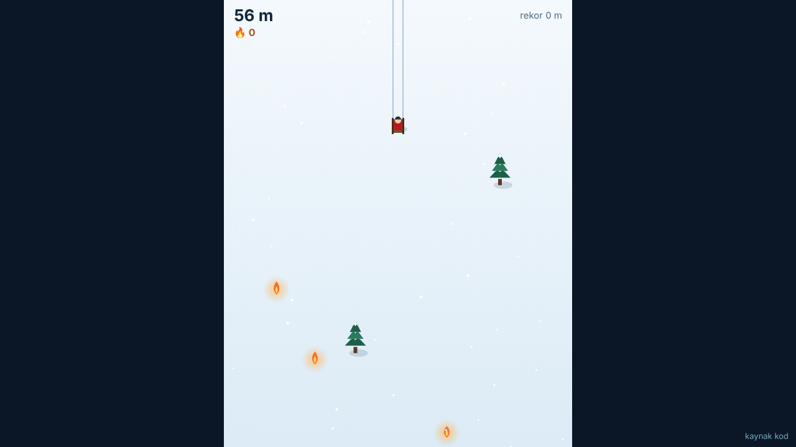

<!-- ENS:TANITIM -->
## 📸 Ekran görüntüsü

<!-- /ENS:TANITIM -->

Tarayıcıda oynanan sonsuz kızak oyunu. Yokuş aşağı kayarsın, hız gittikçe artar; ağaçlara, kayalara ve kardan adamlara çarpmadan ne kadar gidebilirsin?

**[→ Hemen oyna](https://enskygr234.github.io/kizak/)** — kurulum yok, telefonda da çalışır.

## Nasıl oynanır

| | Bilgisayar | Telefon |
|---|---|---|
| Yönlen | `←` `→` ya da `A` `D` | Parmağını sürükle |
| Başla / yeniden | `Boşluk` ya da `Enter` | Dokun |
| Duraklat | `P` ya da `Esc` | — |

- Her 10 piksel 1 metre sayılır; gittikçe hızlanırsın ve engeller sıklaşır.
- 🔥 **Kor** toplarsan 50 metre bonus alırsın.
- Rekorun tarayıcında saklanır.
- Başka pencereye geçersen oyun kendiliğinden duraklar.

## Teknik

- Tek `canvas`, saf JavaScript; kütüphane ve derleme adımı yok.
- Bütün çizimler kodla yapılır, görsel dosyası yoktur.
- Pencere boyutu değişince oyun alanı yeniden ölçeklenir.

Yerelde çalıştırmak için depoyu indirip `index.html` dosyasını tarayıcıda aç.

## Lisans

[MIT](LICENSE) © Winterdeveloper

<!-- ENS:ALT -->
---

**❄️ ENS Developer'ın diğer projeleri**

🎮 Oyunlar: [Mahalle](https://github.com/Enskygr234/mahalle) · [Ayaz Ata'nın Feneri](https://github.com/Enskygr234/ensdewloper.github.io/tree/main/ayaz-feneri) · [Kayıp Fener](https://github.com/Enskygr234/kayip-fener) · [Son Kış](https://github.com/Enskygr234/son-kis) · [Ayazle](https://github.com/Enskygr234/ayazle) · [Buz Kırıcı](https://github.com/Enskygr234/buz-kirici)

[🌐 Bütün projeler](https://enskygr234.github.io/ensdewloper.github.io/) · [👤 GitHub profilim](https://github.com/Enskygr234)

Kış gelir, kod yazılır.

<!-- /ENS:ALT -->
